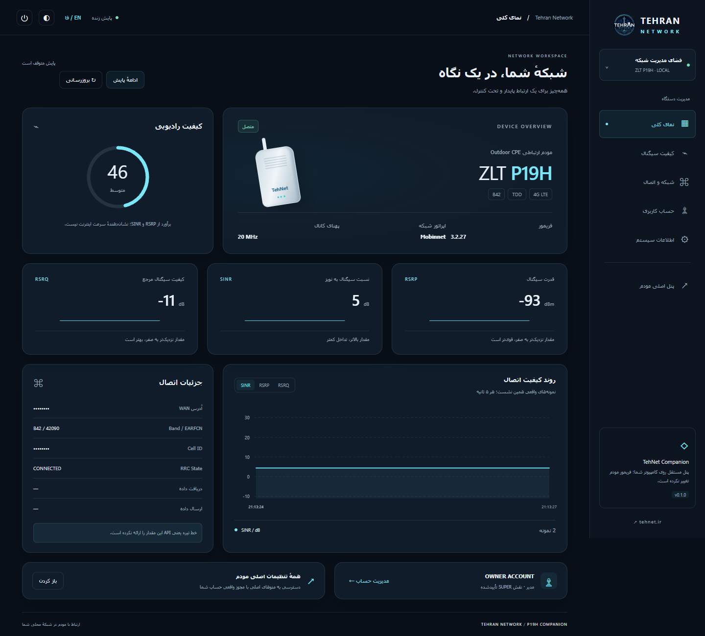

# پنل تهران نتورک برای ZLT P19H

رابط مستقل و سبک برای مدیریت مودم در شبکهٔ محلی: داشبورد واقعی LTE، نمودار
سیگنال، فارسی/انگلیسی، RTL، پوستهٔ روشن/تاریک، موبایل، منوهای اصلی و مدیریت
حساب‌های پشتیبانی‌شده با بکاپ و بازیابی رمزگذاری‌شده.

**این نسخه Companion است و روی کامپیوتر اجرا می‌شود؛ فریمور یا فایل‌های پنل
داخل مودم جایگزین نشده‌اند.** برای استفاده باید کامپیوتر و برنامه روشن بمانند.
پنل فقط روی همان کامپیوتر و `127.0.0.1` باز می‌شود؛ از گوشی دیگر در LAN در
دسترس نیست. طراحی موبایل با اندازهٔ صفحهٔ گوشی در مرورگر آزمایش شده است.



## نصب و اجرا

Python3.10 یا جدیدتر و اتصال اترنت به مودم لازم است. پروژه را دریافت کنید،
از حالت فشرده خارج کنید. برای استفادهٔ روزمره روی `OPEN-PANEL.cmd` کلیک کنید؛
ورود در فرم مرورگر انجام می‌شود. برای Wizard نصب و بکاپ اولیه،
`installer/install.cmd` را اجرا کنید. ابزار مدل،
سخت‌افزار و فریمور را بررسی می‌کند. نام و رمز فعلی را در ورودی محافظت‌شده
بدهید. در حالت مدیر، بکاپ رمزگذاری‌شده ساخته و بازخوانی آن آزمایش می‌شود.
پس از باز شدن پنل، با حساب واقعی مودم وارد شوید.

```powershell
.\installer\install.ps1 -Mode check
.\installer\install.ps1 -Mode install
```

در CMD:

```text
installer\install.cmd --check
installer\install.cmd --dry-run
installer\install.cmd --install
installer\install.cmd --backup
installer\install.cmd --verify
installer\install.cmd --install --apply-accounts
installer\install.cmd --rollback --state "PATH-TO-OWNER-JOURNAL.dpapi"
```

هیچ رمز مشترک، رمز کارخانه، هش اختصاصی یا اطلاعات ورود دستگاه مالک در این
مخزن وجود ندارد. `config.example.yaml` فقط قالب مستندات است و رمزها در نصب
پرسیده می‌شوند. فایل `.env.example` هم ورودی رمز نیست. رمز را داخل فرمان، URL
یا فایل تنظیمات عمومی ننویسید.

## نقش‌ها و محدودیت حساب‌ها

در دستگاه آزمایش‌شده، حساب اصلی عادی و حساب مدیریتی SUPER شناسایی و با ورود
واقعی آزمایش شدند. حسابی که در پنل «Admin» خوانده می‌شود همان حساب SUPER با
`userType=1` است؛ حساب سومِ مدیر از روی نام ظاهری ساخته نمی‌شود. دیگر اسلات‌های
کارخانه نیز در تنظیمات دیده شدند، اما تغییر آن‌ها در نصب‌کننده انجام نمی‌شود.

تغییر نام و رمز حساب عادی اصلی با فرمان‌های بومی ۹۸ و ۱۰۲ تأیید شده است.
تغییر رمز SUPER تأیید شده، ولی تغییر نام SUPER از این مسیر رد می‌شود؛ این نسخه
آن را اجرا نمی‌کند. نام‌های حساب عادی و مدیر در Wizard باید متفاوت باشند تا
رفتار تأییدنشدهٔ نام تکراری موجب از دست‌رفتن دسترسی نشود.

رمزها مخفی دریافت می‌شوند؛ در نصب استاندارد هیچ رمزی ذخیرهٔ متنی نمی‌شود.
بکاپ و Journal بازیابی با Windows DPAPI به کاربر ویندوز و دستگاه فیزیکی مرتبط
هستند. اسلات‌های اصلی فقط پس از بکاپ و آزمایش ورود تازه تغییر می‌کنند. هنگام
شکستِ قابل‌تشخیص، بازیابی محدود همان حساب‌ها انجام می‌شود. اگر پاسخِ یک نوشتن
قطع شود و نتیجه نامشخص باشد، نوشتن تکرار نمی‌شود و بررسی Journal لازم است.

## داده و عملکرد

RSRP، RSRQ، SINR، Band، EARFCN، Cell ID و WAN از API واقعی خوانده می‌شوند.
نمودار تنها نمونه‌های همین نشست را نشان می‌دهد و دادهٔ ساختگی ندارد. کیفیت
نمایشی یک برآورد رادیویی است؛ تست سرعت نیست. اپراتور ثبت‌شده برای نقش مدیر با
خواندن وضعیت شبکه و در صورت عدم دسترسی، اپراتور خانگی سیم‌کارت با برچسب مشخص
نمایش داده می‌شود. اگر مصرف داده از API موجود نباشد، خط تیره نمایش داده می‌شود.

همهٔ منوهای اصلی در تب پنل اصلی باقی هستند؛ تغییرات دستی آن‌ها روی مودم واقعی
اثر دارند. نقش دسترسی از Backend و خواندن محافظت‌شده تعیین می‌شود. نشست تازهٔ
همان حساب می‌تواند نشست قبلی را باطل کند و نیاز به ورود مجدد طبیعی است.

## وضعیت سخت‌افزار و انتشار

پروفایل تأییدشده: `ZLT P19H / TZ7.821.183 / 3.2.27`. مدل‌های هم‌نام P11 و
فریمورهای دیگر سازگار فرض نمی‌شوند. B42 در اتصال واقعی و B43 در اعلان مودم
دیده شده است. این برنامه FDD یا باند جدید اضافه نمی‌کند؛ ظرفیت واقعی فلش یا
RAM را از دیتاشیت مدل‌های مشابه حدس نمی‌زند. فریمور جدید نصب نمی‌شود.

فقط یک مودم فیزیکی مالک آزمایش شده؛ نصب روی مودم دوم ادعا نمی‌شود. انتشار
نهایی Release پس از بازبینی مالک انجام می‌شود. تا آن زمان، فرمان دانلود و
اجرای یک‌خطیِ متکی بر Release موجود ارائه نشده است.

[نصب](docs/INSTALLATION-FA.md) · [قابلیت‌ها](docs/FEATURES-FA.md) ·
[نقش‌ها](docs/ADMIN-ROLES-FA.md) · [بازیابی](docs/RECOVERY-FA.md) ·
[سازگاری](docs/COMPATIBILITY-FA.md)
