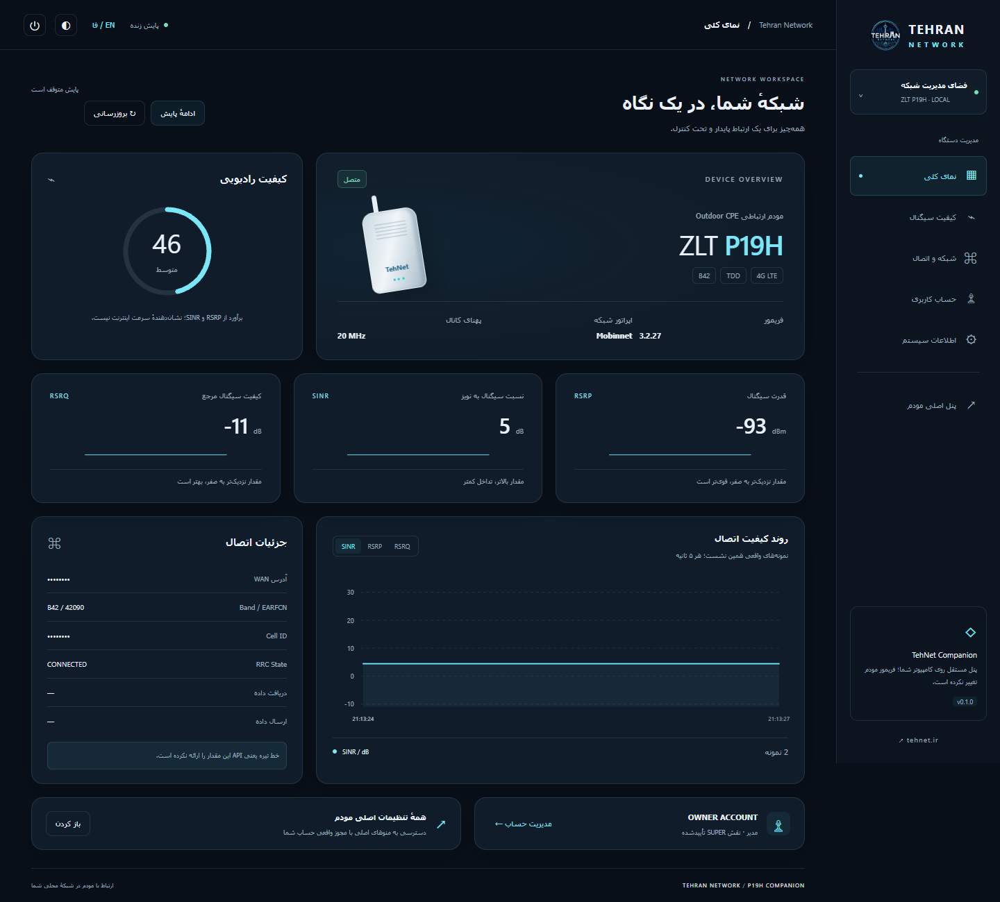

# Tehran Network · ZLT P19H

The [native-router WebUI 0.3](docs/NATIVE-WEBUI-FA.md) runs directly on the owner's
verified modem: all 27 main menus in our workspace, presentation-hidden SUPER
controls, complete available telemetry, colored live charts and measured antenna
alignment. Legacy entry pages redirect to our UI; no legacy iframe is used.
Passwords are preserved. No radio firmware or calibration is installed.
[One-line Windows installation](docs/ONE-LINE-NATIVE-FA.md) ·
[Sanitized device results and limits](docs/DEVICE-RESULTS-FA.md)
[Encrypted original owner recovery backup](docs/OWNER-RECOVERY-FA.md)

Native installation from a checkout (Windows, Python 3.10+, existing authorized
SUPER command console required):

```powershell
python -X utf8 -m tehnet.native_install --check
python -X utf8 -m tehnet.native_install --install
```

The installer below is the separate loopback Companion. Neither version proves
FDD support or universal SIM compatibility. Only one physical P19H was tested.

A lightweight, bilingual local management workspace for the **verified ZLT P19H
3.2.27**. Real LTE signal history, dark/light themes, accessible mobile layouts,
native-menu access, protected account changes and Windows-encrypted recovery.

**This is a companion on your computer, not replacement firmware.** It does not
add FDD bands, unlock unknown RF hardware or flash the modem. Only the owner's
physical P19H has been tested; second-device installation is unverified.

[راهنمای کامل فارسی](README.fa.md) · [Compatibility](docs/COMPATIBILITY-FA.md) ·
[Recovery](docs/RECOVERY-FA.md) · [Security](SECURITY.md)



## Start from a checkout

Install Python3.10+ and keep the Ethernet connection to the modem. No runtime
packages, Node build or elevated Windows privileges are needed.

```powershell
.\installer\install.ps1 -Mode check
.\installer\install.ps1 -Mode install
```

For everyday browser-only sign-in, double-click `OPEN-PANEL.cmd`. For the initial
backup/installer wizard, double-click `installer/install.cmd`. Current credentials are requested in a
protected console prompt; the local browser panel uses the modem's real login.
Passwords are never CLI arguments or repository defaults. Keep the console open
while using the panel. Close it with Ctrl+C. Native modem IP access still works.

Optional account wizard: `installer\install.cmd --install --apply-accounts`.
Backup is mandatory before privileged account changes. Read the role limitations:
ordinary primary username/password and SUPER password changes are verified;
**SUPER username change is not supported by the verified native method**.

## Release status

Source and a checksum-pinned native runtime are published in this repository;
see the one-line installation guide above. No separate GitHub Release is claimed.
The source-package builder writes its ZIP and SHA256 in `dist`.

## Development

```text
python -X utf8 -m unittest discover -s tests -v
python tools/audit_public.py
python tools/package.py
```

Runtime dependencies: Python standard library only. Source: MIT; brand image has
separate terms. shadcn/ui, Tailwind CSS and Lucide were reviewed as design
references; no framework runtime or third-party icon code is bundled. See
[asset/license notes](docs/ASSET-NOTICES.md).

An owner-authorized MCI selection test with the current Mobinnet360 SIM did not
produce an observed MCI connection: six settled observations remained43244/B42.
This does not establish a physical FDD limitation or support for every SIM.
[Operator test and restored-state evidence](docs/OPERATOR-TEST-FA.md).
